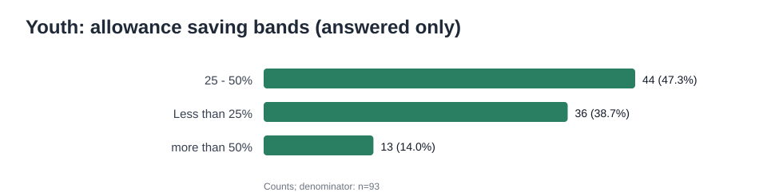
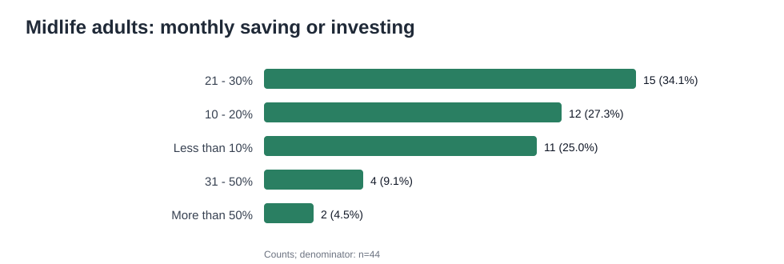
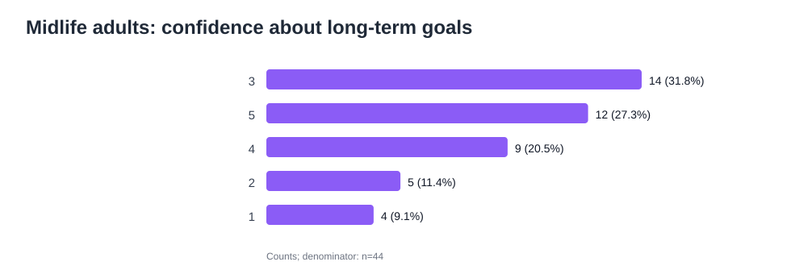

# Financial behavior survey: analysis summary

## Dataset and handling

The workbook contains **166 survey responses** in one response sheet and 50 columns. The analysis removed the timestamp, email address, and full-name fields before calculating any results. The original workbook is not included in this project folder. Question-specific blanks are expected because respondents saw different sections based on their selected age group; they are not treated as one pool of missing answers.

| Self-selected age group | Responses | Share of all responses |
|---|---:|---:|
| Youth (13–22) | 117 | 70.5% |
| Early Adult (23–30) | 4 | 2.4% |
| Midlife Adult (31–50) | 44 | 26.5% |
| Senior (50+) | 1 | 0.6% |

Gender responses were evenly split: 83 Male and 83 Female. The full sample's largest occupation category was Student (116/166). This describes this survey sample only and does not establish representativeness.

## Findings

### Youth (n=117)

- Allowance status: Yes 66, No 28, Maybe 23.
- Saving from allowance was answered by **93** respondents; the distribution below uses that denominator, not all 117 youth.
- 25 - 50%: 44/93 (47.3%).
- Less than 25%: 36/93 (38.7%).
- more than 50%: 13/93 (14.0%).
- 97/117 (82.9%) said they know about saving; 105/117 (89.7%) had heard of investments; 85/117 (72.6%) said they know about financial planning.
- The first-learning-age field yielded **57 numeric answers**. Among those, the median was 15 years (range 6–19); do not read this as a complete-group estimate.

- Monthly allowance bands (n=117): less than ₹500: 59; ₹500–₹1,000: 32; ₹1,001–₹3,000: 17; more than ₹3,000: 9.
- 113/117 (96.6%) said financial literacy should be taught in schools. The spending question allowed multiple selections; Food (100), Travel (63), and Shopping (40) were the most frequent selections.

### Early adults (n=4)

- Monthly saving responses: 3 chose “Less than 20%”, 1 chose “31–50%”.
- Income bands (n=4): Less than ₹20k: 2; ₹20k–₹50k: 1; ₹50k–₹1L: 1. Two reported steady monthly income, one said No, and one said Maybe.
- 3/4 reported having invested. Financial-management confidence had a median of 4.0/5 (n=4).
- With only four respondents, these are sample descriptions. They do not support stable demographic comparisons or a useful correlation analysis.

### Midlife adults (n=44)

- 31/44 (70.5%) reported current loans.
- Investment holdings were multiple-select: Mutual Funds (28/44), Insurance (24/44), Stocks (20/44), Gold (18/44), Real Estate (16/44), and FD (16/44). Counts can exceed the respondent count when summed.
- Monthly saving/investing responses:
- 21 - 30%: 15/44 (34.1%).
- 10 - 20%: 12/44 (27.3%).
- Less than 10%: 11/44 (25.0%).
- 31 - 50%: 4/44 (9.1%).
- More than 50%: 2/44 (4.5%).
- Long-term goal confidence averaged **3.45/5** (median 3; n=44). Self-rated financial management averaged **3.30/5** (median 3; n=44).
- Household situation responses were mostly Comfortable (21) or Stable (18); 5 respondents selected Strained or Dependent on loans/credit combined.
- First-learning-age answers were numeric or parseable for 44/44; median 26 years (range 15–43).

### Seniors (n=1)

The single senior respondent reported being financially well-prepared for retirement and first learning about saving/investing at age 28. This is one person's response and cannot represent seniors as a group.

## Interpretation and limitations

1. The survey is heavily weighted toward Youth and Midlife respondents. Early adults (n=4) and Seniors (n=1) are too small for dependable group comparisons.
2. The age bands are self-selected in the workbook and overlap at age 50 (Midlife 31–50; Senior 50+). Define non-overlapping groups before publishing age-group comparisons.
3. The questionnaire measures self-reported awareness and confidence. It does not appear to test objective financial knowledge, so describe these results as awareness/confidence rather than a measured financial-literacy score.
4. Savings answers are ordered categories rather than exact percentages. Do not calculate an exact average saving rate by substituting arbitrary midpoints unless that assumption is stated and justified.
5. The age-first-learned field is incomplete for Youth and free-text formatting varies in other groups. Numeric summaries use parseable answers only and show their denominator.
6. The data are cross-sectional and self-reported. Associations, if explored in an extended analysis, cannot establish cause and effect. No inferential claim is made here for the four-person Early Adult subgroup.
7. Open-ended answers are not reproduced in this summary. Review and anonymize them before any public release; they can contain identifying details.

## Reproducibility

Run `analysis.ipynb` with the local workbook at `data/survey_responses.xlsx`, or set the `SURVEY_DATA_PATH` environment variable to another local copy. The `.gitignore` excludes workbook and data files by default.
